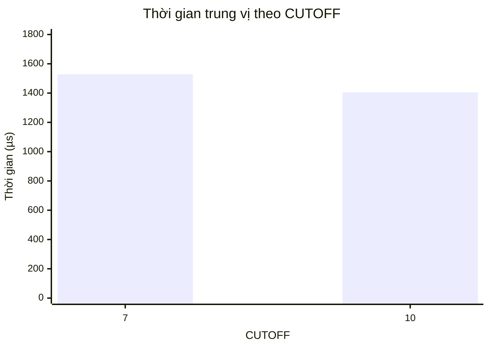

# So sánh CUTOFF 7 và 10

CUTOFF là độ dài lớn nhất của đoạn được sắp xếp bằng Insertion sort. Thí nghiệm so sánh hai giá trị trên cùng một mảng 10.000 số nguyên ngẫu nhiên từ 0 đến 9.999 trong `data.txt`.

## Cách đo

Chạy trên Windows, máy Intel với 12 bộ xử lý logic, JDK 25.0.2 (JVM chạy với `-XX:ActiveProcessorCount=2`). Mỗi giá trị chạy 30 lần làm nóng, sau đó đo 11 lần. Hai giá trị luân phiên chạy trước. Mỗi lần dùng một bản sao của cùng mảng. `System.nanoTime()` đo thời gian sắp xếp. Sao chép mảng và kiểm tra kết quả diễn ra ngoài khoảng đo.

Trung vị là giá trị thứ 6 trong 11 thời gian sau khi xếp từ nhỏ đến lớn. Cách đo lặp lại dựa trên nguyên tắc trình bày trong *Analysis of Algorithms* của Sedgewick và Wayne, trang 9 và 13.

## Kết quả

| Lần đo | CUTOFF 7 (µs) | CUTOFF 10 (µs) |
|---:|---:|---:|
| 1 | 1483.800 | 1476.700 |
| 2 | 1535.200 | 1397.800 |
| 3 | 1487.800 | 1350.100 |
| 4 | 1528.300 | 1355.900 |
| 5 | 1467.600 | 1318.400 |
| 6 | 1393.400 | 1295.100 |
| 7 | 1542.900 | 1508.800 |
| 8 | 1581.500 | 1564.700 |
| 9 | 1524.300 | 1404.700 |
| 10 | 1726.100 | 2173.900 |
| 11 | 2249.700 | 1418.700 |
| **Trung vị** | **1528.300** | **1404.700** |

CUTOFF 10 có trung vị thấp hơn khoảng **8,1%** và nhanh hơn trong 10/11 lần đo. Vì vậy, chọn **CUTOFF 10** giữa hai giá trị trên máy và bộ dữ liệu này.

